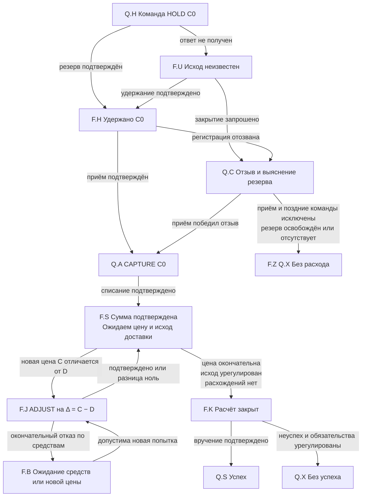

# З-7 Финансовый сценарий управления возвратами

Рассматриваются все три сценария практикума: недоступность биллинга, повтор сообщения о приёме и изменение веса. Состояния Q и F определены в [модели З-6](b-states.md).

По учебному условию возвратная пересылка — отдельная услуга: при оформлении удерживается её стоимость, при приёме резерв превращается в расход, при неприёме освобождается. Тарификатор определяет цену по заявленным, затем фактическим параметрам. Возврат стоимости прямой пересылки в этот сценарий не входит.

Все суммы, интервалы и целевые сроки ниже — учебные допущения. Контракты идемпотентности, отзыва регистрации и окончательности цены являются требованиями решения, а не утверждениями о возможностях действующих API.

## 1 Точки движения денег

Обозначения: L — учётный остаток, H — активные резервы, A = L − H — доступно; D — подтверждённый чистый расход по данному возврату. Цены и проводки хранятся в целых копейках с валютой. Сумма C₀ — исходная цена, C — последняя подтверждённая цена. Примеры используют рубли только для удобства чтения.

| Операция | Связь с состояниями | Эффект |
| --- | --- | --- |
| HOLD на C₀ | Q.D → Q.H; F.N → F.U → F.H | H увеличивается на C₀; L и D не меняются; A уменьшается на C₀ |
| CAPTURE на C₀ | Подтверждён приём, Q.A; F.H → F.P → F.S | H и L уменьшаются на C₀; D увеличивается на C₀; A второй раз не уменьшается |
| RELEASE | Q.C; F.H/U → F.R → F.Z | После доказанного неприёма H уменьшается на подтверждённый резерв; L и D не меняются; A восстанавливается |
| ADJUST на Δ = C − D | F.S → F.J → F.S; при нехватке F.B | При Δ > 0: L − Δ, D + Δ; при Δ < 0: L + abs(Δ), D − abs(Δ). При Δ = 0 проводки нет |
| Закрытие расчёта | F.S → F.K | Денег не двигает; фиксирует окончательную цену и урегулированный исход доставки |

На схеме показаны основные пути; все конфликты и выходы из исключений определены в З-6. Окончательно отклонённый HOLD не требует денежного RELEASE, но закрытие проверяет отсутствие регистрации и позднего удержания. Успешное удержание само по себе не означает готовую заявку.

Удержание предшествует регистрации. Готовность публикуется после обоих подтверждений. Параметры и цена заморожены для этой попытки. Активный резерв не должен самопроизвольно истекать до CAPTURE или подтверждённого RELEASE — это требование к биллингу. Если он поддерживает только резерв с ограниченным сроком, требуется согласованное продление и отзыв регистрации до истечения; без этого готовность к приёму по данной модели не гарантируется.

## 2 Идемпотентность и внешние ключи

| Назначение | Ключ и проверка |
| --- | --- |
| HTTP оформление | `(tenant_id, client_request_id)`; сохраняются хеш нормализованного тела, return_id и результат |
| HOLD | `(tenant_id, return_id, HOLD, reservation_revision)`; после неизвестного ответа revision не меняется |
| CAPTURE | `(tenant_id, return_id, CAPTURE, source_system, acceptance_operation_id)`; дополнительно не более одного успешного базового списания на return_id и reservation_id |
| RELEASE | `(tenant_id, reservation_id, RELEASE)`; допустимо только после доказанного отзыва или неприёма и запрета позднего исполнения |
| Основание корректировки | `(tenant_id, return_id, price_revision)`; целевая цена и её источник сохраняются неизменно |
| Денежная попытка ADJUST | `(tenant_id, return_id, ADJUST, price_revision, attempt_no)`; тело и сумма фиксируются до отправки |
| Доставка сообщения | `(source_system, event_id, consumer_id)` в inbox; этот ключ не заменяет бизнес-основание |

`tenant_id` берётся из авторизованного контекста; чужой ключ не раскрывает чужой результат. Отсутствующий обязательный ключ HTTP-запроса даёт `400` до побочных эффектов. Внешняя строка без устойчивого ID сохраняется как «не сопоставлена» без проводки. Оператор может исправить привязку с журналом и подтверждающим основанием, затем вернуть строку штатному обработчику.

Повтор того же ключа с тем же телом возвращает сохранённый результат либо `202` и ID ожидания. Другое тело — `409 IDEMPOTENCY_CONFLICT`. В транзакции владельца баланса вместе фиксируются ключ попытки, изменение резерва, проводка, статус и outbox. Конкурирующие обработчики сериализуются по записи возврата и счёту; проверка A перед расходом и изменение L выполняются атомарно. Два разных возврата не могут потратить один доступный остаток параллельно. CAPTURE и RELEASE одного резерва взаимоисключаются его состоянием.

### Отказ по средствам и повтор после пополнения

Бизнес-основание и попытка исполнения различаются. Если попытка получила окончательный `DECLINED_INSUFFICIENT_FUNDS`, она не создала проводки; повтор её ключа вернёт тот же отказ. После пополнения создаётся следующий `attempt_no` для того же основания. Сумма вычисляется заново от подтверждённого D. При `PENDING` или `UNKNOWN` номер не меняется, сначала выясняется исход прежней попытки.

На один return_id допускается одна незавершённая денежная попытка. Успех помечает версию цены применённой в той же транзакции, что и проводку; две попытки не могут применить одну версию дважды. Повтор сообщения о пополнении сам по себе не создаёт новую попытку, пока текущая не завершилась. Журнал оснований сохраняется независимо от срока HTTP-кэша.

Новая попытка создаётся только для актуальной подтверждённой цели под блокировкой финансовой записи. Это исключает запуск устаревшей доплаты одновременно с получением более новой цены. При отрицательной цене, другой валюте или несовместимом основании автоматическое исполнение запрещено.

### Версии и исправления

Порядок задаёт версия авторитетного источника по одной сущности, а не время доставки. Старое сообщение не заменяет новую цену; разные тела одной версии отправляются на сверку. Нулевая разница подтверждает применение версии без проводки.

При новой цене во время F.B старая попытка уже окончательно отклонена. Поэтому можно заменить цель и пройти B → J, не требуя устаревшую доплату. Если F.J ещё имеет неизвестный исход, новая цена ждёт выяснения; сумма старой попытки не меняется. Затем разница рассчитывается от фактически проведённого D. Последовательные корректировки не списывают заново полную цену.

Финансовое исправление сверки использует то же денежное основание и тот же путь исполнения, что и обычный обработчик. `incident_id` хранится как ссылка для аудита, но не служит независимым разрешением списать ещё раз: два обращения по одному расхождению не создают две проводки. Поздняя поправка после F.K открывает связанное дело с исходным return_id и отдельной корректирующей попыткой; новый базовый HOLD или CAPTURE запрещён.

Входящее сообщение не помечается обработанным отдельно от сохранения локального эффекта и дальнейшего намерения. После сбоя между фиксацией проводки и ответом повтор возвращает прежний результат. После сбоя до фиксации незавершённая доставка повторяется. Outbox и фоновый опрос незавершённых записей восстанавливают продвижение независимо от открытого экрана.

## 3 Поведение при отказах

### Сценарий 1 Биллинг недоступен при удержании

В t₀ сохраняются Q.H и намерение HOLD. Допущение: тайм-аут вызова 3 с. Отсутствие ответа оставляет F.U — резерв мог уже возникнуть. Клиент получает `202`, номер заявки и сообщение «Проверяем оплату. Повторно оформлять не нужно».

Допущение: чтение результата через 30 с, 2 мин, 5 мин от t₀, затем каждые 5 мин. Повтор команды возможен лишь по тому же ключу при гарантированной идемпотентности смежного API. В 15 мин без готовности атомарно выбирается Q.C. Если подтверждения победили таймер, получится Q.R; если таймер победил, поздняя регистрация не возвращает готовность.

Закрытие сначала исключает регистрацию и физический приём, затем выясняет и освобождает резерв. Неизвестный HOLD закрывается подтверждённым запретом позднего исполнения по ключу. Ответ «не найден» без этой гарантии недостаточен. Если отзыв недоступен, клиент продолжает видеть ожидание, а не завершённую отмену. Подтверждённый приём переводит в Q.A и требует расчёта.

Запрет позднего создания регистрации ставится по исходному ключу её создания, даже если ID не был получен. Запрет позднего HOLD и отзыв регистрации — два разных подтверждения от двух владельцев. Оба нужны до Q.X.

Допущение по срокам: после восстановления нужных API и появления авторитетных результатов цель завершения ближайшего шага — 5 мин. В 24 ч неясного исхода открывается разбор Q.E; цель принятия обращения — 4 ч. Это сроки действий и эскалации, а не гарантия возврата при бессрочном отказе. Новое удержание и фиктивное зачисление по тайм-ауту не выполняются.

Биллинг, регистрация и уведомления обрабатываются отдельными ограниченными пулами. Тайм-аут освобождает ресурс ожидания, состояние и намерение остаются в базе. При повторных отказах защитный выключатель ограничивает новые обращения к неисправной зависимости; периодическая проба и плановая сверка восстанавливают продвижение. Недоступный биллинг не блокирует просмотр карточек и обработку уведомлений. При переполненной очереди система явно отклоняет новое оформление до денежной команды, а уже сохранённые операции продолжает восстанавливать.

### Сценарий 2 Сообщение о приёме пришло повторно

Первое подтверждённое сообщение переводит Q в A и запускает CAPTURE. Повтор event_id поглощается inbox. Если повторная выгрузка дала новый event_id, тот же `source_system + acceptance_operation_id`, уникальность базового расхода на return_id и состояние reservation_id всё равно исключают второе списание.

При конкурентной доставке ключ, проводка и изменение резерва фиксируются атомарно. Другая сумма или другой возврат под прежним ключом дают конфликт без движения денег. Сбой после коммита, но до подтверждения сообщения, не создаёт повторной проводки.

Допущение: обработка обычного дубля — целевая 1 с при доступной базе. Денежного расхождения от такого дубля нет. Дефект реализации проверяется независимой сверкой каждые 5 мин; срок обнаружения считается после появления сопоставимых данных, а не после неизвестного системе факта. Клиент видит один приём и один базовый расход.

### Сценарий 3 Изменился вес при приёме

Приём не отменяется. Тарификатор рассчитывает C по принятому весу и возвращает версию с подтверждением окончательности. Сначала подтверждается базовый CAPTURE, затем применяется Δ = C − D. Пока исход предыдущей проводки неизвестен, новая попытка не запускается. При недоступном тарификаторе базовый расход остаётся, F.S ожидает цену, а завершение F.K и Q.S запрещено.

Учебные допущения для примеров: одна валюта; один возврат; других операций и резервов нет; пополнение уже подтверждено перед повтором; отрицательный доступный остаток запрещён. Каждый ряд — независимый пример.

| Вариант | Допущение | Результат |
| --- | --- | --- |
| Цена выросла | L₀ = 10 000 ₽; C₀ = 300 ₽; C = 360 ₽ | После HOLD: A = 9 700, H = 300. После CAPTURE: L = A = 9 700, H = 0. Доплата 60 даёт L = A = 9 640 ₽ |
| Цена снизилась | L₀ = 10 000 ₽; C₀ = 300 ₽; C = 260 ₽ | После CAPTURE возврат 40 даёт L = A = 9 740 ₽ |
| Приёма нет | L₀ = 10 000 ₽; C₀ = 300 ₽ | После подтверждённого RELEASE: H = 0, L = A = 10 000 ₽, D = 0 |
| Средств мало | L₀ = 330 ₽; C₀ = 300 ₽; C = 360 ₽ | После CAPTURE: A = 30 ₽. Попытка доплаты 60 окончательно отклоняется. Пополнение 30 разрешает новую попытку; после неё A = 0 |
| Цена изменилась во время ожидания средств | D = 300 ₽; попытка до 360 ₽ окончательно отклонена; новая C = 280 ₽ | Вместо старой доплаты 60 проводится возврат 20 ₽ по новой версии |
| Последовательные корректировки | D = 360 ₽; новая C = 340 ₽ | Возвращается 20 ₽; исходные 300 ₽ повторно не учитываются как база разницы |

Допущение: после получения цены и доступности баланса ближайшая проверка и попытка — в пределах 5 мин. При нехватке показываются текущая цель, доступный остаток и минимальное пополнение. Если поступила новая цена, сумма к пополнению обновляется. В 24 ч ожидания цены, результата проводки или средств — Q.E и разбор. Обычное ожидание доставки при уже подтверждённой окончательной сумме относится к отдельному сроку контроля доставки из З-6. Отказ доставки после приёма не означает автоматический возврат тарифа: отдельное основание возмещения должно быть согласовано до окончательного закрытия.

### Сравнение вариантов

| Подход | Преимущество | Цена и ограничение |
| --- | --- | --- |
| Только синхронные вызовы | Простой немедленный ответ при доступных сервисах | Потерянный ответ всё равно даёт неизвестный исход; без журнала и чтения по ключу безопасного повтора нет |
| Saga с компенсациями | Явное описание известных частичных отказов | Компенсации тоже требуют ключей, повторов и контроля; физический приём необратим |
| Фоновые шаги и сверка — выбранный вариант | Процесс переживает недоступность и находит молчаливые расхождения | Клиент временно ждёт; необходимы сроки, сверка и ручной контур |

В выбранной модели обычный дубль расхождения не создаёт. Самое долгое ожидание может возникнуть как при недоступности источника, так и при непополненном балансе: верхней границы восстановления или действия клиента нет. Если цена и деньги доступны, сценарий веса решается следующим циклом. Сравнение длительностей без этих условий было бы неверным.

При отказе источника клиент платит временем ожидания и временно связанным резервом. При изменившемся весе он получает доплату либо возврат разницы, а при нехватке средств — незавершённый расчёт до пополнения или согласованного урегулирования. При обычном дубле дополнительного списания и финансового ожидания нет.

## 4 Обнаружение расхождений

Допущение: оперативная сверка каждые 5 мин; полный контроль ежедневно в 03:00 МСК. Она читает API или реестры авторитетных владельцев независимо от брокера и локальных уведомлений. Если источник недоступен, фиксируется пробел в данных и возраст последней успешной сверки; неизвестные данные не считаются совпавшими.

| Объекты | Ключ сопоставления | Проверка |
| --- | --- | --- |
| Заявка и возвратное отправление | tenant_id, return_id, return_tracking_id; source_system, operation_id, revision | Приём и итог доставки относятся к правильному встречному отправлению; прямой tracking_id не подменяет возвратный |
| Заявка и резерв | tenant_id, return_id, reservation_revision, reservation_id | Готовая заявка имеет нужный резерв; закрытая без приёма не имеет резерва и поздних команд |
| Приём и CAPTURE | tenant_id, return_id, source_system, acceptance_operation_id, reservation_id | Не более одного базового расхода; принятый возврат с подтверждённым резервом, но без CAPTURE обнаруживается как незавершённый |
| Цена и проводки | tenant_id, return_id, price_revision | D = сумма CAPTURE + доплаты − возвраты; при F.K значение D равно окончательной C |
| Счёт и журнал | организация, договор, счёт, валюта, период | Начальный L + пополнения − чистый расход = конечный L; отдельно сумма активных резервов и A = L − H |

Сравнение проводится на общей подтверждённой границе данных; отсутствие более свежей записи не принимается за отсутствие операции. Допущение для оперативного окна — последние 24 ч плюс все незавершённые записи. Полный контроль включает весь открытый период. Изменения закрытых периодов читаются по курсору/версии источника, а если такого канала нет — повторной полной выгрузкой затронутого периода.

Сверка находит приём без расхода, расход без приёма, потерянное освобождение, осиротевший резерв, дубли, несовпадение валюты или суммы и незавершённую корректировку. Она также проверяет успешно закрытые возвраты, поэтому поздний конфликт после Q.S или Q.X не исчезает из контроля. Общая ошибочная запись сразу в двух источниках одной сверкой не обнаруживается; для этого нужны независимые основания приёма и цены.

Однозначно потерянный ответ восстанавливается чтением результата. Неоднозначный случай получает обращение, ответственное лицо, ожидаемые и фактические значения. Поправка проходит тем же обработчиком и по тем же основаниям, что штатная операция. Оператор не удаляет проводки и не выставляет успешный баланс вручную.

Допущения контроля: больше 10 мин без успешной сверки — сигнал; денежная операция старше 24 ч — эскалация. При доступных источниках и готовых данных обнаружение происходит ближайшим циклом. Исправление — целевые 5 мин после подтверждения основания и доступности исполнения; неоднозначный случай имеет срок принятия в работу, а не выдуманный срок зачисления.

## 5 Промежуточный экран

| Ситуация | Отображение и действие |
| --- | --- |
| HOLD неизвестен | Номер заявки; «Проверяем оплату»; время последнего подтверждения и следующей проверки. Повторное оформление недоступно |
| Отмена запрошена | «Подтверждаем отмену и освобождение средств». Отдельно — подтверждённый резерв; деньги ещё не объявлены доступными |
| Принято, расчёт ждёт | Физический приём с временем источника; отдельно — списанная сумма и причина ожидания цены или корректировки |
| Не хватает средств | Допущение примера: цена 360 ₽, списано 300 ₽, доступно 30 ₽; доплата 60 ₽, минимальное пополнение 30 ₽ |
| Снимок баланса устарел | «Доступно 9 700 ₽ по данным на 16:50 МСК; обновляем». Сумма и время — допущение примера |
| Просрочка | ID обращения, причина и срок следующего сообщения о ходе. Допущение: обновление не реже чем через 4 ч |

Учётный L, резерв H, доступный A и ожидаемое изменение показываются раздельно. Ожидаемый возврат не увеличивает подтверждённый A; ожидающая доплата тоже не считается уже списанной. Решение о новой операции принимает авторитетный владелец баланса в транзакции. Число на экране и предварительная проверка не резервируют средства.

При неизвестном HOLD доступный снимок помечается как устаревший; если владелец не может подтвердить A, новый расход не разрешается на основании этого снимка. Просмотр истории остаётся доступен. Клиент узнаёт результат после закрытия экрана через сохранённую карточку, API статуса или уведомление.

Если после закрытия появилась авторитетная поправка, исторический исход Q не стирается. В карточке отдельно показываются связанное дело, новая ожидающая сумма и его текущий статус, чтобы прежнее завершение не скрывало новое обязательство.

В массовой загрузке у каждой строки свой return_id и устойчивый ключ запроса. Повтор файла возвращает результаты прежних строк, а ошибка одной строки не отменяет остальные. Итоги разделяют успешные, ожидающие и отклонённые строки; суммы агрегируются по подтверждённым проводкам.

Основания: учебный финансовый сценарий занятия 7 и модель занятия 6. Числа в этом решении являются допущениями, а не показателями реального контура.
