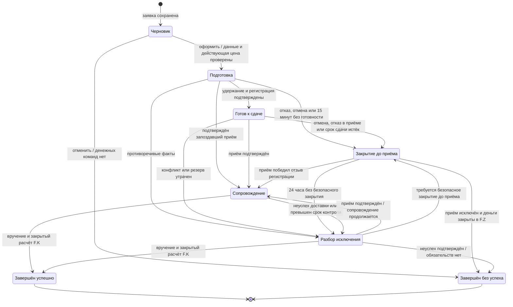
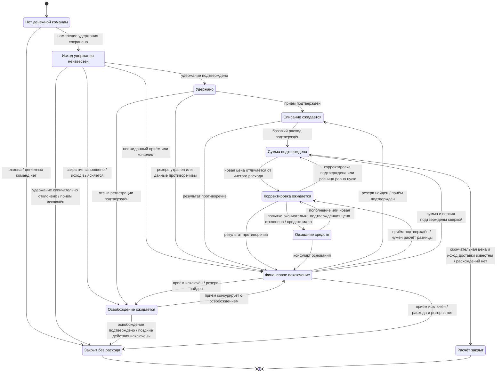

# З-6 Машина состояний управления возвратами

Моделируется заявка на возврат, а не физическое движение прямого отправления. Возвратное отправление имеет собственный почтовый идентификатор; ссылка на прямое может отсутствовать. REST API владеет заявкой Q, Онлайн Баланс API — финансовой записью F. Физический статус принадлежит почтовой сети и хранится в кабинете как проекция с версией и временем источника.

Денежные правила соответствуют учебному условию З-7: резерв при оформлении, расход при приёме, освобождение резерва при неприёме, корректировка по фактическому весу. Все интервалы ниже — учебные допущения. Детали расчётов и ключей приведены в [З-7](a-finance.md).

## 1 Диаграмма состояний

Из Q.H регистрация отправляется только после подтверждённого удержания. Если её ответ потерян, готовность ещё не публикуется, но внешний приём уже может состояться; поэтому предусмотрен Q.H → Q.A. В Q.C поздний ответ о регистрации не возвращает Q.R. Подтверждённый физический приём имеет приоритет над намерением отмены.

### Финансовый автомат

F.S — промежуточное состояние: сумма уже подтверждена, но окончательная цена или исход доставки ещё могут ожидаться. Конечные состояния F — только K и Z. Переход S → K проверяет `price_final`, соответствие суммы окончательной версии, отсутствие незавершённых денежных попыток и решение по исходу доставки. Он не требует конечного Q, поэтому взаимного ожидания автоматов нет. Q закрывается после подтверждённого F.K или F.Z.

Приём после подтверждённого освобождения противоречит контракту регистрации. До закрытия это F.E; после закрытия создаётся связанное дело. Оно выполняет только необходимые корректировки по исходному `return_id`, сохраняя прежние основания и запрет повторного базового списания. Новый HOLD или CAPTURE для уже закрытого возврата не создаётся.

## 2 Определение состояний

| Состояние Q | Разрешено | Запрещено |
| --- | --- | --- |
| D Черновик | Исправить данные, запросить тариф, оформить, отменить | Удерживать без действующей цены; задавать физический приём |
| H Подготовка | Проверять прежние операции, запросить отмену | Менять замороженные параметры; выдавать готовность до двух подтверждений |
| R Готов к сдаче | Получить идентификатор, запросить отмену до приёма | Повторно удерживать; списывать без приёма |
| A Сопровождение | Обновлять отслеживание, завершать расчёт | Отменять физический приём; возвращать заявку в D |
| C Закрытие до приёма | Отозвать регистрацию, выяснить и освободить резерв | Объявлять отмену и возврат денег по одному тайм-ауту |
| E Разбор исключения | Сверить источники и продолжить подтверждённый путь | Выставлять успех без основания; вручную менять баланс |
| S Успешно | Читать вручение и итог расчёта | Переоткрывать заявку; удалять историю |
| X Без успеха | Читать причину; создать новую связанную заявку | Возобновлять закрытую заявку; скрывать денежные обязательства |

| Состояние F | Разрешено | Запрещено |
| --- | --- | --- |
| N Нет команды | Начать удержание или закрыть отменённый черновик | Проводить расход до приёма |
| U Неизвестный исход | Проверять удержание по прежнему ключу; запросить закрытие | Считать тайм-аут отказом; менять ключ неизвестной попытки |
| H Удержано | Дождаться приёма либо подтверждённого отзыва | Тратить резерв второй раз; свободно редактировать сумму |
| P Списание ожидается | Проверить результат CAPTURE | Одновременно освободить тот же резерв |
| S Сумма подтверждена | Подтвердить версию без проводки, скорректировать сумму или закрыть расчёт | Объявлять весь расчёт завершённым без окончательной цены |
| R Освобождение ожидается | Выяснить исход и закрыть освобождение | Показывать резерв уже возвращённым до подтверждения |
| Z Закрыт без расхода | Читать подтверждённый результат | Возобновлять удержание; повторно зачислять сумму |
| J Корректировка ожидается | Выполнить или проверить текущую попытку | Запускать следующую денежную попытку при неизвестном исходе |
| B Ожидание средств | После окончательного отказа дождаться пополнения или новой цены | Повторять старый отказ как новую проводку; требовать устаревшую доплату |
| E Исключение | Восстановить факты и выбрать разрешённый переход | Исправлять баланс удалением проводки |
| K Расчёт закрыт | Читать итог; открыть связанное дело при позднем исправлении | Открывать новый цикл удержания для прежнего возврата |

История доступна в любом состоянии после проверки прав. Статусы почтовой сети не редактируются пользователем кабинета. Потерянные или старые сообщения не понижают уже подтверждённую версию проекции.

## 3 Запрещённые переходы

Для каждой отсутствующей пары «состояние — команда» действует отказ без побочного эффекта. Авторизация проверяется до чтения результата по ключу. Для новой команды после этого проверяются данные, версия записи и условия перехода.

| Состояние | Попытка | Ответ |
| --- | --- | --- |
| Q.D | Списать стоимость | `409 NOT_ACCEPTED` |
| Q.H или Q.C | Оформить заново по той же заявке с другим ключом | `409 OPERATION_PENDING` и ID текущей операции |
| Q.H или Q.R | Изменить адрес либо заявленный вес | `409 PARAMETERS_LOCKED`; после подтверждённого закрытия можно создать новую заявку |
| Q.A или Q.S | Отменить физический приём или перейти в D | `409 ACCEPTANCE_IRREVERSIBLE` |
| Q.C | Закрыть без доказательства неприёма | `409 RESULT_UNKNOWN` |
| Q.S или Q.X | Переоткрыть запись | `409 TERMINAL_STATE`; поздняя поправка идёт отдельным делом |
| Любое Q | Установить физический статус вручную | `403 EXTERNAL_STATE_OWNER` |
| F.P или принятый возврат | Выполнить RELEASE | `409 ACCEPTANCE_CONFIRMED` |
| F.J при неизвестном результате | Создать другую денежную попытку | `409 OPERATION_PENDING` |
| F.K или F.Z | Повторно начать удержание | `409 TERMINAL_STATE` |
| Любое | Прислать прежний ключ с другим нормализованным телом | `409 IDEMPOTENCY_CONFLICT` |
| Любое | Выполнить новую команду с устаревшей версией | `409 VERSION_CONFLICT` |

Повтор с тем же ключом и телом не является новой командой: возвращается сохранённый результат либо `202` и ID ожидающей операции. Результат проверяется до проверки актуальной версии состояния, поэтому успешный повтор не превращается в конфликт из-за последующего перехода. Неизвестная команда возвращает `409 INVALID_STATE`, неверные данные — `422 VALIDATION_ERROR`, отсутствие обязательного ключа — `400 MISSING_IDEMPOTENCY_KEY`.

## 4 Точка невозврата

Граница проходит по физическому приёму встречного отправления. В заявке ему соответствует Q.A. Даже если сообщение задержалось, внешнее действие уже произошло. После приёма можно исправлять денежный расчёт или открывать претензию, но нельзя отменить движение посылки возвратом Q в черновик.

До приёма отмена требует подтверждения от владельца регистрации. Отзыв и приём должны взаимоисключаться в одной версии регистрации: победил приём — продолжаются доставка и расчёт; победил отзыв — новый приём по этой регистрации запрещён. Одно чтение «приём не найден» не даёт такого доказательства.

Если ответ на создание регистрации потерян и её ID ещё неизвестен, отзыв должен также закрыть исходный ключ создания. Иначе запоздавшая команда могла бы создать регистрацию уже после отмены. Локальный запрет отправлять новые команды не останавливает запрос, который уже передан внешнему сервису.

Если внешний API не поддерживает отзыв с этой гарантией, автоматическое закрытие блокируется. Запрос остаётся ожидающим и передаётся на разбор; интерфейс не обещает немедленную отмену. Выдача идентификатора сама по себе ещё не делает логистическую операцию необратимой, если регистрацию можно надёжно отозвать.

## 5 Недоступность смежного сервиса

| Сервис | Состояние | Что видит клиент |
| --- | --- | --- |
| Тарификатор до оформления | Q.D, F.N | «Цена временно недоступна». Денежной операции нет |
| Удержание | Q.H, F.U | «Проверяем оплату. Повторно оформлять не нужно», номер заявки и следующая проверка |
| Регистрация после удержания | Q.H, F.H | «Ожидаем подтверждение оформления». Через 15 минут начинается Q.C, освобождение ещё ожидается |
| Отслеживание | Прежнее Q.R или Q.A | Последний подтверждённый статус, его время и отметка задержки; отмена ждёт ответа владельца регистрации |
| Базовое списание или корректировка | Q.A, F.P либо F.J | Приём показан отдельно от ожидающего расчёта |
| Тарификатор после приёма | Q.A, F.S после базового списания | «Отправление принято. Ожидаем окончательную цену»; Q.S запрещено |
| Уведомления | Зафиксированное Q и F сохраняется | Результат доступен в карточке; уведомление может запоздать |

Допущения по времени: один внешний запрос — 3 с; проверки от начала подготовки — через 30 с, 2 мин, 5 мин и далее каждые 5 мин. В 15 мин неготовая заявка переходит в Q.C атомарно по версии. После этого позднее подтверждение готовности не возвращает Q.R. В 24 ч ожидания денежного ответа, окончательной цены, средств на доплату или подтверждаемого закрытия — Q.E и обращение; цель принятия обращения в работу — 4 ч. Срок считается от начала соответствующего незавершённого этапа; повтор его не обнуляет. Таймер запускает действие системы, но не доказывает, что деньги уже вернулись.

Допущение по сроку сдачи — 7 календарных дней после Q.R; превышение запускает подтверждаемый отзыв. Допущение по контролю доставки — 30 календарных дней после приёма; превышение запускает разбор, но не устанавливает потерю. После приёма отказ доставки завершается Q.X только при подтверждённом исходе и урегулированных обязательствах. Если правило возмещения ещё не согласовано, Q.E остаётся открытым.

Ожидание обычной доставки с подтверждённой окончательной суммой не является просрочкой денежного этапа: для него действует срок контроля доставки. После эскалации возврат из E к исполнению требует зафиксированного решения и нового срока контроля этапа. Возраст исходной операции сохраняется, а повторная проверка не создаёт дубли обращений. Это исключает немедленный цикл E → A/C → E по уже истёкшему дедлайну.

## 6 Переходы и уведомления

| Переход | Владелец и условие |
| --- | --- |
| Q.D → Q.H | REST API замораживает параметры и сохраняет намерение удержания |
| F.N → F.U → F.H | Онлайн Баланс API создаёт и подтверждает резерв |
| Q.H → Q.R | REST API имеет подтверждения резерва и регистрации |
| Q.H/R/C → Q.A | REST API проверил авторитетный физический приём |
| F.H → F.P → F.S | Онлайн Баланс API превратил резерв в базовый расход по основанию приёма |
| F.S → F.J → F.S | Онлайн Баланс API подтвердил разницу до новой цены |
| F.J → F.B → F.J | Попытка окончательно отклонена; пополнение или новая цена разрешает следующую попытку |
| Q.H/R → Q.C; F.U/H → F.R → F.Z | Отмена с доказанным неприёмом и отсутствием поздних денежных команд |
| F.S → F.K; Q.A → Q.S | Сначала закрыт расчёт, затем успешная заявка с подтверждённым вручением |

Стрелка между сервисами не является общей транзакцией. Каждый владелец меняет только свою базу и проверяет свои условия.

| Уведомление | Если не доставлено | Владелец исходного состояния | При повторе |
| --- | --- | --- | --- |
| Заявка сохранена или Q изменено | Q отправителя уже сохранено; проекция потребителя отстаёт | REST API | Inbox и версия проекции исключают повторный эффект и откат назад |
| Удержание, расход или освобождение подтверждено | F уже изменено; Q ждёт результата или сверки | Онлайн Баланс API | Ключ денежного основания и сохранённый результат исключают новую проводку |
| Физический приём или вручение | Почтовая операция уже произошла; локальная проекция отстаёт | Почтовая сеть | Сопоставляются источник, ID операции и версия; конфликт передаётся на сверку |
| Данные для аналитики или сообщение клиенту | Исходные Q и F сохраняются | Владелец исходного факта | Повторное получение не должно создавать повторный бизнес-эффект |

Локальная транзакция сохраняет состояние, журнал и outbox вместе. На входе inbox, локальный эффект и исходящая команда также фиксируются вместе. Нельзя отметить сообщение обработанным, а денежную команду потерять до её сохранения. Подтверждение брокеру отправляется после коммита. Запись «получено» с ещё не выполненным намерением остаётся доступна фоновому обработчику.

Уведомление о приёме — следствие перехода в почтовой сети и входной факт для решения владельца Q. Получение сообщения не даёт права менять чужую сущность. Для уведомлений человеку гарантируется сохранённое намерение и повтор доставки; при неизвестном ответе внешнего канала абсолютное отсутствие повторного письма без поддержки ключей этим каналом не обещается.

## Проверки модели

Все состояния Q и F достижимы из начала; из каждого есть путь к допустимому конечному состоянию при выполнении условий интеграции. У Q два конечных исхода S и X; у F — K и Z. Из них нет исходящих бизнес-переходов. Это структурная завершимость, а не гарантия завершения при бессрочном отказе внешней системы.

Автоматические этапы имеют сроки эскалации; дальнейшее продвижение исключения контролируется ответственным. Неуспех имеет явный исход, а неопределённость остаётся ожиданием или исключением. Для любой недопустимой команды задан общий отказ и перечислены существенные частные случаи.

Основания: занятия 6 и 7. Состояния и контракты выше — предлагаемая модель фичи.
